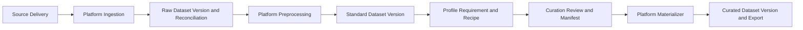

<p align="center">
  <picture>
    <source media="(prefers-color-scheme: dark)" srcset="media/lerobot-logo-thumbnail.png">
    <source media="(prefers-color-scheme: light)" srcset="media/lerobot-logo-thumbnail.png">
    
  </picture>
  <br/>
  <br/>
</p>

<div align="center">

[](https://github.com/huggingface/lerobot/actions/workflows/nightly-tests.yml?query=branch%3Amain)
[](https://codecov.io/gh/huggingface/lerobot)
[](https://www.python.org/downloads/)
[](https://github.com/huggingface/lerobot/blob/main/LICENSE)
[](https://pypi.org/project/lerobot/)
[](https://pypi.org/project/lerobot/)
[](https://github.com/huggingface/lerobot/tree/main/examples)
[](https://github.com/huggingface/lerobot/blob/main/CODE_OF_CONDUCT.md)
[](https://discord.gg/s3KuuzsPFb)

</div>

<br/>

<h3 align="center">
    <p>LeRobot: State-of-the-art AI for real-world robotics</p>
</h3>

---

🤗 LeRobot aims to provide models, datasets, and tools for real-world robotics in PyTorch. The goal is to lower the barrier to entry to robotics so that everyone can contribute and benefit from sharing datasets and pretrained models.

🤗 LeRobot contains state-of-the-art approaches that have been shown to transfer to the real-world with a focus on imitation learning and reinforcement learning.

🤗 LeRobot already provides a set of pretrained models, datasets with human collected demonstrations, and simulation environments to get started without assembling a robot. In the coming weeks, the plan is to add more and more support for real-world robotics on the most affordable and capable robots out there.

🤗 LeRobot hosts pretrained models and datasets on this Hugging Face community page: [huggingface.co/lerobot](https://huggingface.co/lerobot)

## Local Data Platform

Public source distribution: [publication boundaries and installation notes](docs/public_distribution.md).

**开发／生产双环境：** 新部署使用显式 `--env dev|prod`，开发验证后将同一份版本包发布到生产。
首次初始化、角色切换、升级和回退请按 [双环境部署指南](docs/data_platform_environments.md) 操作。
账号统一使用 username；改密和管理员重置流程见 [账号与密码恢复](docs/data_platform_accounts.md)。

### 平台能力与文档入口

平台采用 Server A 统一管理、Agent 就地计算的方式，支持 LeRobot v2.1/v3.0、UMI，以及
已适配的 GenDAS MCAP 导入。处理默认生成独立输出；源数据写回需要单独授权和确认。

| 工作 | 入口与能力 | 操作说明 |
| --- | --- | --- |
| 数据发现 | 选择授权目录或子路径；Scan 即时发现，Refresh 读取登记；记住浏览目录 | [页面手册](docs/data_platform_page_user_guide.md#31-第一次加载数据集) |
| 数据理解 | 多视角 Viewer、Action/State 曲线、Analysis、只读 Parquet/CSV Inspect | [Explore](docs/data_platform_page_user_guide.md#7-explore-可视化中心与-analysis) |
| 质量复核 | 按信号启用控制、标注、关节、末端、数值和媒体检查；报告连接 Viewer 人工复核 | [Quality](docs/data_platform_page_user_guide.md#54-data-curation--quality-review) |
| 标注与构建 | 批量时序描述、可选信号、Review、版本化 Workspace/Manifest 与新数据集物化 | [时序标注](docs/temporal_caption_trial.md)、[生命周期](docs/data_lifecycle_architecture.md) |
| 任务管理 | 节点/用户配额、分阶段进度、安全停止/重试、MCAP 检查点恢复、管理员单任务额外配额 | [Jobs](docs/data_platform_page_user_guide.md#11-jobs-抽屉与-pipeline-runs) |
| 发布与恢复 | 不可变包、开发验收后生产批准、兼容滚动升级、缓存发布与结果确认 | [运维手册](docs/data_platform_operations.md) |

能力和操作说明以本分支源码为准；安装版本及在线验收以各环境发行记录为准。
完整索引见[文档导航](docs/README.md)。

**AI 助手：** 点击右下角 **AI assistant**，或按 **Ctrl/Cmd + Shift + Space** 唤出、收起侧栏；
聊天时仍可操作平台。默认跟随页面、数据集和 Viewer Episode，读取授权的 Instruction 等元数据；可固定上下文。操作卡片放在对应消息中，已有结果和运行进度紧凑显示。支持上下文解读、流程草稿，以及 Viewer、Quality、标注和单数据集派生处理的确认卡片。
网页与 [CLI](clients/data-platform-cli/README.md) 共用历史会话、个人偏好和显式长期记忆；已确认助手任务由后台跟进，在 Updates 中显示终态总结；使用服务端配置的 Qwen，
用户无需模型密钥。操作权限和确认规则不变，详见 [助手说明](docs/data_platform_operators.md#qwen-draft-assistant)。
卡片先检查已有结果与正在运行的任务，再提供结果入口或一键确认；历史结果会注明配置或产物是否可核实。
网页与 CLI 共用状态判断；CLI 的 `/open` 查看结果链接，`/confirm again` 明确重新运行。
当前已发布 CLI 版本以 latest 和发行验收记录为准；CLI 支持[后台经验增强](docs/data_platform_hindsight.md)、`/memory`、`/updates`，外部助手接入见 [MCP 文档](docs/data_platform_mcp.md)。CLI 启动时显示网页地址，`/web` 随时查看，`--web` 免登录输出；CLI 0.3.2 起用 `data-platform update` 升级，旧版本先运行一次 `latest` 安装命令。

**版本更新：** 功能与兼容性变化记录在 [发行变更](docs/data_platform_changelog.md)，
当前架构见 [平台情况说明](docs/distributed_data_platform_current_status.md)。
文档描述源码能力，实际安装版本以环境状态和验收记录为准。

**远程列表访问：** 数据集、任务列表及任务进度使用摘要响应，避免重复下载逐 episode 元数据和
完整转换报告；进度、权限和输出链接保留。Datasets 页始终显示 Server 和扫描目录选项。
排障见 [运维手册](docs/data_platform_operations.md)。

**MCAP 导入：** Data Platform → Data Import 支持 GenDAS MCAP → LeRobot v3.0，
先预检、再转换，默认每个目录最多 3 个文件。重启导致计算进程丢失时，自动重新排队并复用完整文件检查点，
连续自动恢复最多 3 次。操作与部署配置见 [MCAP 导入指南](docs/data_platform_mcap_import.md)。


Task definitions are configurable in the console. Existing Pick/Place/Give tasks and new task families share versioned catalogs, dataset mappings, analysis and curation filters, and portable Agent configuration snapshots. See the [task onboarding guide](docs/data_platform_task_catalog.md).

**Data Inspect:** Select a dataset and open **Explore → Inspect → Open data inspect** to preview
actual Parquet records or stored Viewer CSV values, 50 rows at a time (maximum 200). Fields are
searchable, arrays expand as JSON, and previews remain read-only. Remote datasets use published CSV
without contacting the Agent. See the [page user guide](docs/data_platform_page_user_guide.md).

### Run Analysis without preparing caches

Select a dataset and open **Explore → Dataset Analysis → Open analysis**. **Refresh analysis**
runs analysis directly; neither action starts Prepare cache or a remote preparation job.
Tasks, attributes, episode counts, frame counts, and durations come from dataset metadata.
Duration is episode length divided by FPS. Existing CSV files optionally supply stage and
object-presence distributions; missing optional files are shown as **Not generated**, not review flags.

Remote Analysis uses the latest metadata synced by the Agent, even when no Viewer cache exists or
the Agent is offline. The page shows the report's sync time. Update Server A first, then update the
Agent and wait for its automatic metadata sync to include episode lengths (`analysis_metadata_version=1`). Older reports
still provide known totals and task distributions; unavailable per-episode values remain empty.
Preparing videos is only needed when you want to use the Viewer. Analysis does not modify source data.

### Shared Qwen API key on Server A

Task suggestions, Qwen API object labeling, and VLM auto-tagging use the same server-side
`DASHSCOPE_API_KEY`. Configure it once in the deployed service environment:

```bash
sudoedit /etc/data-platform/dev/server.env
```

Add or update these entries in that file (replace the key placeholder there):

```ini
DASHSCOPE_API_KEY=YOUR_QWEN_API_KEY
DASHSCOPE_BASE_URL=https://dashscope.aliyuncs.com/compatible-mode/v1
DATA_PLATFORM_TASK_MODEL=qwen3.6-plus
```

Keep the endpoint in the same region as your key. `DATA_PLATFORM_TASK_MODEL` only controls task
suggestions; image labeling and tagging retain their own model selectors. Save the file, then run:

```bash
sudo chmod 640 /etc/data-platform/dev/server.env
sudo systemctl restart data-platform-web@dev.service
sudo systemctl status data-platform-web@dev.service --no-pager -l
```

This example targets development. Configure production separately in `prod/server.env` and
use its matching service during an authorized maintenance window. Legacy single-environment
installations may still use `/etc/data-platform/server.env`; check the actual unit before editing.

For a code update, run `data-platform-update-all --env prod --release RELEASE` after development acceptance, following the deployment
workflow below. That updater preserves the environment file. This Qwen feature runs on Server A
and does not require another Agent upgrade or distributing the API key to Agents.

In **Task setup**, load instructions, select the latest catalog, and click **Suggest with AI**.
Review the proposed tasks, select the ones to keep, then click **Save selected & preview → Apply
to dataset**. Suggestions use unique instruction texts and the catalog; generating and reviewing
them require no Prepare cache. Saving suggestions creates a catalog version, while **Apply to
dataset** remains the explicit mapping update and background CSV refresh.

In **Auto labeling** and **Auto-tagging**, choose the Qwen API backend and leave the API key field
empty to use the shared key. Explicit keys still override it. A custom endpoint requires its own
explicit key (or `EMPTY` for a local unauthenticated server), unless it is configured centrally with
`DASHSCOPE_BASE_URL`. The Qwen Gradio backend retains its separate ModelScope token.
The browser receives only whether the shared key is configured. Keep the real key out of source
files and shell command arguments. See the [task setup guide](docs/data_platform_task_catalog.md#ai-assisted-task-setup).

### Start the web console

The Data Platform is included with LeRobot and does not require a separate installation. Before
starting it, install this repository by following the [Installation](#installation) instructions
below.

Start the platform with a directory containing one or more local datasets:

```bash
python -m lerobot.data_platform --root /path/to/datasets
```

The home page recursively discovers directories containing `meta/info.json` and exposes two
logical workspaces in the same process:

- **Data Platform** is the supply and execution plane for ingestion, preprocessing, immutable
  dataset versions, lineage, and materialization.
- **Data Curation** is the decision plane for exploration, quality review, annotation, cohort
  selection, profiling, versioned requirements/recipes, and dataset construction.

The two workspaces continue to share the dataset selector, Viewer, Job & Artifacts panel, and
operation audit log. The implementation lives in [`lerobot/data_platform`](lerobot/data_platform).
For a central MySQL-backed service with node agents on multiple servers, see the
[distributed deployment guide](docs/distributed_data_platform_deployment.md).

The platform always operates on real LeRobot metadata and trajectory data. It reports invalid
inputs instead of replacing them with fabricated samples. Data Construction also preserves the
source observation and action values; it creates training variants by changing task metadata,
bookkeeping indices, and `exist_label`.

### Platform overview



Published raw, standard, and curated dataset versions are immutable. Stable `episode_uid` values
live in portable Identity Artifacts outside dataset roots; physical copies are registered as
`DatasetReplica` records. Curation edits first live in revision-controlled Workspaces and are
frozen into versioned manifests. Versioned preprocessing/materialization Profiles separate
content-affecting configuration from runtime options. The materializer is idempotent, persists its
state in SQLite, validates row counts, timestamps, metadata, and complete file SHA256 values, then
atomically registers the logical version and output replica.

### Modules and capabilities

| Domain | Main modules | What the UI can do |
| --- | --- | --- |
| Platform — ingestion and versions | `lifecycle.py`, `lifecycle_repository.py`, `routes/lifecycle.py` | Full-hash local datasets, register immutable versions/replicas and portable identity artifacts, inspect explicit episode lineage. |
| Platform — delivery and reconciliation | `lifecycle.py`, `routes/lifecycle.py` | Register source deliveries and explain every received/accepted/excluded/repaired/generated Episode transition. |
| Platform — preprocessing and materialization | `precompute/preprocess/`, `lifecycle.py` | Execute versioned Profiles and idempotently materialize a published manifest through a persisted validation state machine. |
| Curation — understand and quality | `viewer.py`, `precompute/analysis.py`, `precompute/compare/`, `precompute/embedding/`, `precompute/preprocess/quality_flags.py` | Explore trajectories, distributions, embeddings, comparisons, technical issues, and semantic quality evidence. |
| Curation — enrichment and selection | `precompute/annotation.py`, `precompute/labeling/`, `precompute/tagging/`, `precompute/construction/` | Edit revision-controlled Workspaces containing stage, prompt, bbox, tag, include/exclude, trim, and value-edit decisions before publishing a manifest. |
| Curation — profile and recipe | `lifecycle.py`, `routes/lifecycle.py` | Publish Dataset Profiles and Requirements, resolve fixed cohorts, and compile deterministic Recipes into reviewable Workspaces. |

The data-processing area is divided into smaller modules:

| Processing module | Capabilities |
| --- | --- |
| Feature conversion (`action_dim.py`, `field_ops.py`) | Trim action/state vectors to a target dimension and remove selected fields from parquet data and feature metadata. |
| Signal processing (`smooth_action.py`) | Apply centered temporal smoothing to action values and, when requested, state values. |
| Dataset standardization (`standardize.py`) | Run the platform's combined cleanup pipeline: normalize DVT2 grippers, align action/state dimensions, remove depth fields, write stage/subtask data, and repair indices. |
| Dataset composition (`dataset_split.py`, `dataset_merge.py`, `dataset_subtract.py`) | Create task/episode subsets, combine datasets with remapped metadata, or remove episodes that exactly match episodes in other datasets. |
| Quality and metadata repair (`quality_flags.py`, `flag_fixes.py`, `flag_clear.py`, `prompt_rewrite.py`) | Detect data-quality problems, apply supported repairs, review task/prompt assignments, and clear resolved flags. |
| Episode maintenance (`delete_episodes.py`) | Delete selected episodes in place, reindex the remaining data and metadata, and attempt rollback if the operation fails. |

Dataset merge defaults to strict signal schemas and dimension order. Use
`--preprocess-merge-dimension-policy min` (or **Signal dimensions → Minimum** in the Merge page)
to align each action/state field to the smallest source layout by complete, unique dimension names.
Missing dimensions or incompatible robot semantics/units are rejected. Dry run reports the mappings
and dropped dimensions; execution writes a new dataset and rebuilds its signal statistics and CSV cache.
The same Merge form supports multiple datasets on one Agent after Server A and that Agent are updated.
Remote merge validates registered location IDs and path boundaries, then uploads the new Viewer cache
and registers the output. Cross-Agent merging is not supported.

The default console path does not expose direct source-dataset mutation controls. Cache,
analysis, Workspaces, manifests, and lifecycle records live outside the source dataset; preprocessing
and materialization create sibling outputs. The normal startup command also provides a password-
protected Admin Mode in the browser. On first entry, set the local administrator password for that
dataset root; later entries require the same password. The password is stored only as a salted hash,
and Admin Mode remains active until explicitly exited or the browser session ends. Episode deletion
requires an impact confirmation and a reason recorded in the operation audit log. Remote source
mutation confirmation on the Datasets page requires typing only `MUTATE`.

To mark one or more read-only source zones at startup, repeat `--protected-source-root`. The console
also exposes the same policy on the Datasets page. Protected datasets can be reviewed and used to
create sibling outputs, but every legacy in-place delete, repair, or overwrite request is rejected.

```bash
python -m lerobot.data_platform \
  --root /path/to/datasets \
  --protected-source-root /path/to/raw_data
```

Admin Mode can modify or delete source Parquet, videos, and metadata and should not be used for
normal curation work.

When `DATA_PLATFORM_DATABASE_URL` enables the central multi-user service, the central `admin` role
replaces this separate local Admin Mode login. Administrators receive admin controls immediately
after signing in. Self-registered accounts remain pending until an administrator approves them;
approved accounts start as read-only `viewer` users with no delete permission.

See [`docs/data_lifecycle_architecture.md`](docs/data_lifecycle_architecture.md) for the capability
matrix, persisted contracts, API mapping, lifecycle states, and materialization invariants.

## Deployment

Configure your own hosts, data roots, credentials, trusted CA and network policy.
This public source distribution contains no hosted platform endpoint or bundled model weights.
Start locally using the instructions above; deployment procedures are in the
[environment guide](docs/data_platform_environments.md) and
[operations guide](docs/data_platform_operations.md).

## Installation

Download our source code:
```bash
git clone --branch data-platform https://github.com/Beaconsyh08/embodied-data-loop.git
cd embodied-data-loop
```

Create a virtual environment with Python 3.10 and activate it, e.g. with [`miniconda`](https://docs.anaconda.com/free/miniconda/index.html):
```bash
conda create -y -n lerobot python=3.10
conda activate lerobot
```

When using `miniconda`, install `ffmpeg` in your environment:
```bash
conda install ffmpeg -c conda-forge
```

> **NOTE:** This usually installs `ffmpeg 7.X` for your platform compiled with the `libsvtav1` encoder. If `libsvtav1` is not supported (check supported encoders with `ffmpeg -encoders`), you can:
>  - _[On any platform]_ Explicitly install `ffmpeg 7.X` using:
>  ```bash
>  conda install ffmpeg=7.1.1 -c conda-forge
>  ```
>  - _[On Linux only]_ Install [ffmpeg build dependencies](https://trac.ffmpeg.org/wiki/CompilationGuide/Ubuntu#GettheDependencies) and [compile ffmpeg from source with libsvtav1](https://trac.ffmpeg.org/wiki/CompilationGuide/Ubuntu#libsvtav1), and make sure you use the corresponding ffmpeg binary to your install with `which ffmpeg`.

Install 🤗 LeRobot:
```bash
pip install -e .
```

> **NOTE:** If you encounter build errors, you may need to install additional dependencies (`cmake`, `build-essential`, and `ffmpeg libs`). On Linux, run:
`sudo apt-get install cmake build-essential python3-dev pkg-config libavformat-dev libavcodec-dev libavdevice-dev libavutil-dev libswscale-dev libswresample-dev libavfilter-dev pkg-config`. For other systems, see: [Compiling PyAV](https://pyav.org/docs/develop/overview/installation.html#bring-your-own-ffmpeg)

For simulations, 🤗 LeRobot comes with gymnasium environments that can be installed as extras:
- [aloha](https://github.com/huggingface/gym-aloha)
- [xarm](https://github.com/huggingface/gym-xarm)
- [pusht](https://github.com/huggingface/gym-pusht)

For instance, to install 🤗 LeRobot with aloha and pusht, use:
```bash
pip install -e ".[aloha, pusht]"
```

To use [Weights and Biases](https://docs.wandb.ai/quickstart) for experiment tracking, log in with
```bash
wandb login
```

(note: you will also need to enable WandB in the configuration. See below.)

## Walkthrough

```
.
├── examples             # contains demonstration examples, start here to learn about LeRobot
|   └── advanced         # contains even more examples for those who have mastered the basics
├── lerobot
|   ├── configs          # contains config classes with all options that you can override in the command line
|   ├── common           # contains classes and utilities
|   |   ├── datasets       # various datasets of human demonstrations: aloha, pusht, xarm
|   |   ├── envs           # various sim environments: aloha, pusht, xarm
|   |   ├── policies       # various policies: act, diffusion, tdmpc
|   |   ├── robot_devices  # various real devices: dynamixel motors, opencv cameras, koch robots
|   |   └── utils          # various utilities
|   └── scripts          # contains functions to execute via command line
|       ├── eval.py                 # load policy and evaluate it on an environment
|       ├── train.py                # train a policy via imitation learning and/or reinforcement learning
|       ├── control_robot.py        # teleoperate a real robot, record data, run a policy
|       ├── push_dataset_to_hub.py  # convert your dataset into LeRobot dataset format and upload it to the Hugging Face hub
|       └── visualize_dataset.py    # load a dataset and render its demonstrations
├── outputs               # contains results of scripts execution: logs, videos, model checkpoints
└── tests                 # contains pytest utilities for continuous integration
```

### The `LeRobotDataset` format

A dataset in `LeRobotDataset` format is very simple to use. It can be loaded from a repository on the Hugging Face hub or a local folder simply with e.g. `dataset = LeRobotDataset("lerobot/aloha_static_coffee")` and can be indexed into like any Hugging Face and PyTorch dataset. For instance `dataset[0]` will retrieve a single temporal frame from the dataset containing observation(s) and an action as PyTorch tensors ready to be fed to a model.

A specificity of `LeRobotDataset` is that, rather than retrieving a single frame by its index, we can retrieve several frames based on their temporal relationship with the indexed frame, by setting `delta_timestamps` to a list of relative times with respect to the indexed frame. For example, with `delta_timestamps = {"observation.image": [-1, -0.5, -0.2, 0]}`  one can retrieve, for a given index, 4 frames: 3 "previous" frames 1 second, 0.5 seconds, and 0.2 seconds before the indexed frame, and the indexed frame itself (corresponding to the 0 entry). See example [1_load_lerobot_dataset.py](examples/1_load_lerobot_dataset.py) for more details on `delta_timestamps`.

Under the hood, the `LeRobotDataset` format makes use of several ways to serialize data which can be useful to understand if you plan to work more closely with this format. We tried to make a flexible yet simple dataset format that would cover most type of features and specificities present in reinforcement learning and robotics, in simulation and in real-world, with a focus on cameras and robot states but easily extended to other types of sensory inputs as long as they can be represented by a tensor.

Here are the important details and internal structure organization of a typical `LeRobotDataset` instantiated with `dataset = LeRobotDataset("lerobot/aloha_static_coffee")`. The exact features will change from dataset to dataset but not the main aspects:

```
dataset attributes:
  ├ hf_dataset: a Hugging Face dataset (backed by Arrow/parquet). Typical features example:
  │  ├ observation.images.cam_high (VideoFrame):
  │  │   VideoFrame = {'path': path to a mp4 video, 'timestamp' (float32): timestamp in the video}
  │  ├ observation.state (list of float32): position of an arm joints (for instance)
  │  ... (more observations)
  │  ├ action (list of float32): goal position of an arm joints (for instance)
  │  ├ episode_index (int64): index of the episode for this sample
  │  ├ frame_index (int64): index of the frame for this sample in the episode ; starts at 0 for each episode
  │  ├ timestamp (float32): timestamp in the episode
  │  ├ next.done (bool): indicates the end of an episode ; True for the last frame in each episode
  │  └ index (int64): general index in the whole dataset
  ├ episode_data_index: contains 2 tensors with the start and end indices of each episode
  │  ├ from (1D int64 tensor): first frame index for each episode — shape (num episodes,) starts with 0
  │  └ to: (1D int64 tensor): last frame index for each episode — shape (num episodes,)
  ├ stats: a dictionary of statistics (max, mean, min, std) for each feature in the dataset, for instance
  │  ├ observation.images.cam_high: {'max': tensor with same number of dimensions (e.g. `(c, 1, 1)` for images, `(c,)` for states), etc.}
  │  ...
  ├ info: a dictionary of metadata on the dataset
  │  ├ codebase_version (str): this is to keep track of the codebase version the dataset was created with
  │  ├ fps (float): frame per second the dataset is recorded/synchronized to
  │  ├ video (bool): indicates if frames are encoded in mp4 video files to save space or stored as png files
  │  └ encoding (dict): if video, this documents the main options that were used with ffmpeg to encode the videos
  ├ videos_dir (Path): where the mp4 videos or png images are stored/accessed
  └ camera_keys (list of string): the keys to access camera features in the item returned by the dataset (e.g. `["observation.images.cam_high", ...]`)
```

A `LeRobotDataset` is serialised using several widespread file formats for each of its parts, namely:
- hf_dataset stored using Hugging Face datasets library serialization to parquet
- videos are stored in mp4 format to save space
- metadata are stored in plain json/jsonl files

Dataset can be uploaded/downloaded from the HuggingFace hub seamlessly. To work on a local dataset, you can specify its location with the `root` argument if it's not in the default `~/.cache/huggingface/lerobot` location.

### Evaluate a pretrained policy

Check out [example 2](./examples/2_evaluate_pretrained_policy.py) that illustrates how to download a pretrained policy from Hugging Face hub, and run an evaluation on its corresponding environment.

We also provide a more capable script to parallelize the evaluation over multiple environments during the same rollout. Here is an example with a pretrained model hosted on [lerobot/diffusion_pusht](https://huggingface.co/lerobot/diffusion_pusht):
```bash
python lerobot/scripts/eval.py \
    --policy.path=lerobot/diffusion_pusht \
    --env.type=pusht \
    --eval.batch_size=10 \
    --eval.n_episodes=10 \
    --policy.use_amp=false \
    --policy.device=cuda
```

Note: After training your own policy, you can re-evaluate the checkpoints with:

```bash
python lerobot/scripts/eval.py --policy.path={OUTPUT_DIR}/checkpoints/last/pretrained_model
```

See `python lerobot/scripts/eval.py --help` for more instructions.

### Train your own policy

Check out [example 3](./examples/3_train_policy.py) that illustrates how to train a model using our core library in python, and [example 4](./examples/4_train_policy_with_script.md) that shows how to use our training script from command line.

To use wandb for logging training and evaluation curves, make sure you've run `wandb login` as a one-time setup step. Then, when running the training command above, enable WandB in the configuration by adding `--wandb.enable=true`.

A link to the wandb logs for the run will also show up in yellow in your terminal. Here is an example of what they look like in your browser. Please also check [here](./examples/4_train_policy_with_script.md#typical-logs-and-metrics) for the explanation of some commonly used metrics in logs.


Note: For efficiency, during training every checkpoint is evaluated on a low number of episodes. You may use `--eval.n_episodes=500` to evaluate on more episodes than the default. Or, after training, you may want to re-evaluate your best checkpoints on more episodes or change the evaluation settings. See `python lerobot/scripts/eval.py --help` for more instructions.

#### Reproduce state-of-the-art (SOTA)

We provide some pretrained policies on our [hub page](https://huggingface.co/lerobot) that can achieve state-of-the-art performances.
You can reproduce their training by loading the config from their run. Simply running:
```bash
python lerobot/scripts/train.py --config_path=lerobot/diffusion_pusht
```
reproduces SOTA results for Diffusion Policy on the PushT task.

## Contribute

If you would like to contribute to 🤗 LeRobot, please check out our [contribution guide](https://github.com/huggingface/lerobot/blob/main/CONTRIBUTING.md).

<!-- ### Add a new dataset

To add a dataset to the hub, you need to login using a write-access token, which can be generated from the [Hugging Face settings](https://huggingface.co/settings/tokens):
```bash
huggingface-cli login --token ${HUGGINGFACE_TOKEN} --add-to-git-credential
```

Then point to your raw dataset folder (e.g. `data/aloha_static_pingpong_test_raw`), and push your dataset to the hub with:
```bash
python lerobot/scripts/push_dataset_to_hub.py \
--raw-dir data/aloha_static_pingpong_test_raw \
--out-dir data \
--repo-id lerobot/aloha_static_pingpong_test \
--raw-format aloha_hdf5
```

See `python lerobot/scripts/push_dataset_to_hub.py --help` for more instructions.

If your dataset format is not supported, implement your own in `lerobot/common/datasets/push_dataset_to_hub/${raw_format}_format.py` by copying examples like [pusht_zarr](https://github.com/huggingface/lerobot/blob/main/lerobot/common/datasets/push_dataset_to_hub/pusht_zarr_format.py), [umi_zarr](https://github.com/huggingface/lerobot/blob/main/lerobot/common/datasets/push_dataset_to_hub/umi_zarr_format.py), [aloha_hdf5](https://github.com/huggingface/lerobot/blob/main/lerobot/common/datasets/push_dataset_to_hub/aloha_hdf5_format.py), or [xarm_pkl](https://github.com/huggingface/lerobot/blob/main/lerobot/common/datasets/push_dataset_to_hub/xarm_pkl_format.py). -->


### Add a pretrained policy

Once you have trained a policy you may upload it to the Hugging Face hub using a hub id that looks like `${hf_user}/${repo_name}` (e.g. [lerobot/diffusion_pusht](https://huggingface.co/lerobot/diffusion_pusht)).

You first need to find the checkpoint folder located inside your experiment directory (e.g. `outputs/train/2024-05-05/20-21-12_aloha_act_default/checkpoints/002500`). Within that there is a `pretrained_model` directory which should contain:
- `config.json`: A serialized version of the policy configuration (following the policy's dataclass config).
- `model.safetensors`: A set of `torch.nn.Module` parameters, saved in [Hugging Face Safetensors](https://huggingface.co/docs/safetensors/index) format.
- `train_config.json`: A consolidated configuration containing all parameters used for training. The policy configuration should match `config.json` exactly. This is useful for anyone who wants to evaluate your policy or for reproducibility.

To upload these to the hub, run the following:
```bash
huggingface-cli upload ${hf_user}/${repo_name} path/to/pretrained_model
```

See [eval.py](https://github.com/huggingface/lerobot/blob/main/lerobot/scripts/eval.py) for an example of how other people may use your policy.


### Improve your code with profiling

An example of a code snippet to profile the evaluation of a policy:
```python
from torch.profiler import profile, record_function, ProfilerActivity

def trace_handler(prof):
    prof.export_chrome_trace(f"tmp/trace_schedule_{prof.step_num}.json")

with profile(
    activities=[ProfilerActivity.CPU, ProfilerActivity.CUDA],
    schedule=torch.profiler.schedule(
        wait=2,
        warmup=2,
        active=3,
    ),
    on_trace_ready=trace_handler
) as prof:
    with record_function("eval_policy"):
        for i in range(num_episodes):
            prof.step()
            # insert code to profile, potentially whole body of eval_policy function
```

## Citation

If you want, you can cite this work with:
```bibtex
@misc{cadene2024lerobot,
    author = {Cadene, Remi and Alibert, Simon and Soare, Alexander and Gallouedec, Quentin and Zouitine, Adil and Palma, Steven and Kooijmans, Pepijn and Aractingi, Michel and Shukor, Mustafa and Aubakirova, Dana and Russi, Martino and Capuano, Francesco and Pascale, Caroline and Choghari, Jade and Moss, Jess and Wolf, Thomas},
    title = {LeRobot: State-of-the-art Machine Learning for Real-World Robotics in Pytorch},
    howpublished = "\url{https://github.com/huggingface/lerobot}",
    year = {2024}
}
```

Additionally, if you are using any of the particular policy architecture, pretrained models, or datasets, it is recommended to cite the original authors of the work as they appear below:

- [Diffusion Policy](https://diffusion-policy.cs.columbia.edu)
```bibtex
@article{chi2024diffusionpolicy,
	author = {Cheng Chi and Zhenjia Xu and Siyuan Feng and Eric Cousineau and Yilun Du and Benjamin Burchfiel and Russ Tedrake and Shuran Song},
	title ={Diffusion Policy: Visuomotor Policy Learning via Action Diffusion},
	journal = {The International Journal of Robotics Research},
	year = {2024},
}
```
- [ACT or ALOHA](https://tonyzhaozh.github.io/aloha)
```bibtex
@article{zhao2023learning,
  title={Learning fine-grained bimanual manipulation with low-cost hardware},
  author={Zhao, Tony Z and Kumar, Vikash and Levine, Sergey and Finn, Chelsea},
  journal={arXiv preprint arXiv:2304.13705},
  year={2023}
}
```

- [TDMPC](https://www.nicklashansen.com/td-mpc/)

```bibtex
@inproceedings{Hansen2022tdmpc,
	title={Temporal Difference Learning for Model Predictive Control},
	author={Nicklas Hansen and Xiaolong Wang and Hao Su},
	booktitle={ICML},
	year={2022}
}
```

- [VQ-BeT](https://sjlee.cc/vq-bet/)
```bibtex
@article{lee2024behavior,
  title={Behavior generation with latent actions},
  author={Lee, Seungjae and Wang, Yibin and Etukuru, Haritheja and Kim, H Jin and Shafiullah, Nur Muhammad Mahi and Pinto, Lerrel},
  journal={arXiv preprint arXiv:2403.03181},
  year={2024}
}
```

### UMI LeRobot v3 数据

支持 UMI 三路内嵌图像、头部/左右手位姿及夹爪原始信号的预览、基础分析、拆分和同结构合并。
数据列表显示机器人类型与 LeRobot 版本；DVT1/DVT2 保留为旧处理流程的参数。
兼容 DVT 的处理默认使用 DVT2，Quality 无需手工确认；只有需要旧规则时才主动选择 DVT1。
UMI 不套用 DVT 归一化或自动 Stage，也不生成训练用 action/state。
配置外部运行环境后，Pipelines 中的 `umi.cosmos_id` / `umi.replay` 可运行 laundry 算子，并打开原版 Cosmos 和 Viser 可视化。
首次 clone 请先按 [data-laundry 安装与配置](docs/data_laundry_setup.md) 获取固定源码、安装独立环境并检查配置。
安装脚本支持授权 Git 镜像，不使用 submodule；Cosmos 权重和 Tracker 校准资源需要单独准备。
回放读取已保存的执行轨迹，模型候选不自动发布为训练数据。
操作、来源追踪与 Server A → Agent 升级顺序见 [UMI 数据支持](docs/umi_dataset_support.md)。

### 多用户日志与任务管理

不同维度的 Minimum/Padding 合并及页面显式映射配置见
[不同维度的数据集合并](docs/data_platform_merge_alignment.md)。

Agent 文件权限、任务提交反馈及 operator 删除 episode 的审批流程见
[执行权限与删除审批](docs/data_platform_permissions.md)。

集中部署支持在现有管理员控制面页面查看使用日志和只读数据库记录。协议 2 Agent 支持持久化执行批次、
排队优先级、取消及符合条件的重试/终止；本地后台任务使用独立本地执行器和兼容的 `/api/jobs` 查询。
管理员可在 Platform management → Jobs 点击 **Use extra quota (+1)**，给指定排队任务增加一个用户并发名额，
仍遵守节点总并发和数据锁；排队时可撤回，手动重试需重新授权。
需要配置独立日志库、安装本地执行器并升级 Agent。部署顺序、能力限制及存储分工见
[多用户管理与任务执行](docs/data_platform_multi_user_management.md)。

日常更新先在开发环境验收候选包，再执行 `data-platform-update-all --env prod --release RELEASE`。
工具保留环境配置，维护期间备份并更新 Server、本地执行器和对应 Agent，最后校验节点心跳。
首次环境初始化、旧生产接入和回退步骤见 [双环境部署指南](docs/data_platform_environments.md)。

### 单条数据分段与 Caption 实验

需要通过 Python 调用离线 FLORA 时，可独立部署 [FLORA HTTP API](docs/flora_http_api.md)：
支持 API Key、异步任务、本地整数据集上传与已授权的服务器数据集，最多八张 GPU 并行处理 episodes，
与平台共用 GPU 锁。该服务独立发布，不替换平台 Server/Agent 或绕过平台网页确认流程。

在 `Data Curation → Annotation → Temporal Caption` 平行查看三视角视频和分段 caption，
选择 FLORA（本地分段、Caption、Reward）、Multi-view Semantics（多视角语义分段）、Video + Events（视频事件分段）或 Fusion + Review（融合及独立复核），
按 episode 查看双语 caption、运动曲线和各自结果版本。Fusion V2 在本地计算信号变化、候选边界来源和时间一致性矩阵，
再由模型进行语义融合与独立复核。支持按 episode 区间或整个数据集提交标注 Jobs，并选择是否输入 action/state 等信号；
FLORA 使用已配置的 80 GB GPU、仅输入视频，在 Review 保留原始 Reward 窗口及评分分歧，支持点击回看。
支持每卡一个 episode、最多 8 卡并行；复用未变化文件的校验结果并流式生成视频，资源配置和分阶段验收见下方文档。
不覆盖现有标注，不回写源数据。运行步骤、范围和结果复核限制见
[Temporal Caption 实验](docs/temporal_caption_trial.md)。

### Data Platform operators and pipelines

The data console includes versioned sequential pipelines, a unified operator catalog, review-gated pose repairs and existing Agent/Job execution. See the [architecture and API guide](docs/data_platform_operators.md).

### Text memory annotation

Registered Agent datasets can use **Annotation → Text memory** for causal Qwen drafts,
authenticated revisioned Review and approved high-level exports. A separately installed frozen
training snapshot can be browsed read-only against its matching video and stopped-review evidence;
Temporal Caption Review also displays source-matched memory alongside captions. See the
[Text memory contract](docs/memory_annotation.md). Real-provider pilot and installed acceptance
are separate from the synthetic implementation checks; no model training is started.

### Offline MEM export

For versioned raw multiview exports of selected segmentation/caption artifacts, see
[MEM export](docs/mem_export.md). Run `python -m lerobot.data_platform.mem_export --help`
on the source host; the command does not modify source datasets or platform state.

Administrator-managed [workflow strategy experiments](docs/data_platform_strategies.md) are available
as an opt-in source feature. Strategies are evaluated against a baseline and require manual activation;
private memory and task confirmation remain unchanged. Server/Agent/CLI deployment acceptance is separate.

External Codex/Claude Code access: [MCP setup and credential management](docs/data_platform_mcp.md).


Authorized usage learning, private opt-in analysis and offline strategy review are documented in
[Continuous learning](docs/data_platform_continuous_learning.md). New model budgets default to zero;
feedback does not execute tasks or automatically activate strategies.
