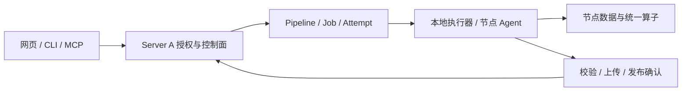
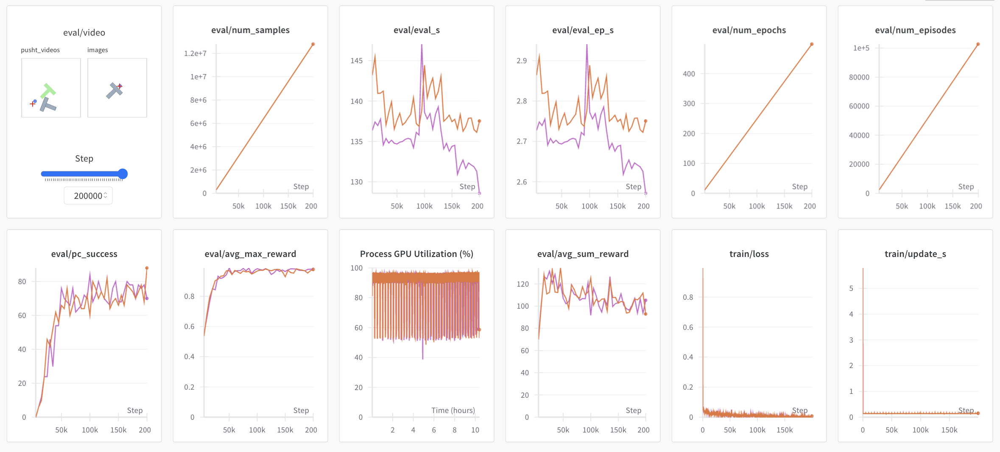

# Embodied Data Loop · Data Platform

基于 🤗 LeRobot 的数据管理、可视化、处理与审核平台。Server A 提供统一控制面，
各数据节点的 Agent 就地计算，网页和轻量 CLI 共用账号、权限与任务记录。

[文档导航](docs/README.md) · [页面手册](docs/data_platform_page_user_guide.md) ·
[CLI 安装](clients/data-platform-cli/README.md) · [开发与源码结构](docs/data_platform_development.md) ·
[发行变更](docs/data_platform_changelog.md)

本文描述本分支源码。当前安装版本、Agent 能力和在线验收以各环境的发行记录为准。
LeRobot 的本地安装、训练和评估入口保留在下方 [Installation](#installation) 与 [Walkthrough](#walkthrough)。

## Local Data Platform

Public distribution: [publication boundaries](docs/public_distribution.md).
Configure your own service addresses, network policy, external sources and model resources.

### 平台能力与文档入口

| 工作 | 当前源码能力 | 文档 |
| --- | --- | --- |
| 数据发现与浏览 | 授权目录 Scan、登记 Refresh、多视角 Viewer、原始信号、Analysis 与只读 Inspect | [页面手册](docs/data_platform_page_user_guide.md) |
| 数据格式与导入 | LeRobot v2.1/v3.0、UMI 三路内嵌图像、GenDAS MCAP 转换、按 episode 读取的混合评测集 | [UMI](docs/umi_dataset_support.md)、[MCAP](docs/data_platform_mcap_import.md) |
| 质量与构建 | 关节/末端/数值/媒体检查、人工 Keep/Exclude、版本化 Workspace/Manifest、独立输出 | [统一 Curation](docs/data_platform_unified_curation.md)、[生命周期](docs/data_lifecycle_architecture.md) |
| 算子与任务 | 版本化顺序 Pipeline、节点与用户配额、分阶段进度、取消/重试、有限的 MCAP 检查点恢复 | [算子与流程](docs/data_platform_operators.md)、[任务管理](docs/data_platform_multi_user_management.md) |
| 标注与评测 | Temporal Caption、FLORA、文本记忆草稿/Review、人工参考修订及试点评分 | [时序标注](docs/temporal_caption_trial.md)、[文本记忆](docs/memory_annotation.md)、[FLORA 评测](docs/flora_evaluation_pilot.md) |
| UMI 诊断与候选 | Tracker 诊断、版本对比、Replay 与 Cosmos 候选、原版报告和 Viser 查看器 | [UMI 工作流](docs/umi_dataset_support.md)、[data-laundry 安装](docs/data_laundry_setup.md) |
| AI 与外部接入 | 上下文问答、待确认操作、网页/CLI 历史与显式记忆、受限 MCP | [助手](docs/data_platform_operators.md#qwen-draft-assistant)、[CLI](clients/data-platform-cli/README.md)、[MCP](docs/data_platform_mcp.md) |
| 独立 FLORA 服务 | 独立 API、流式上传、任务查询和 GPU 后端路由 | [FLORA HTTP API](docs/flora_http_api.md) |

处理默认生成独立输出；源数据写回仍需专门授权、路径检查和确认。
模型结果、质量候选、回放通过与人工批准分别记录；混合评测集不自动成为通用训练数据。

### Start the web console

平台随本仓库安装。开发环境准备见 [开发指南](docs/data_platform_development.md)，
本地查看已授权的数据目录：

```bash
python -m lerobot.data_platform --root /path/to/datasets
```

Data Platform 与 Data Curation 共用数据选择、Viewer、Jobs 和审计日志。
本地 Admin Mode、源保护及 `full` / `visualize` 的操作边界见
[页面手册](docs/data_platform_page_user_guide.md#2-进入页面与账号权限)。
集中部署的用户使用管理员提供的网页地址或 [CLI 安装入口](clients/data-platform-cli/README.md)。

### Run Analysis without preparing caches

选择数据集，进入 **Explore → Dataset Analysis → Open analysis**。Analysis 可直接使用元数据；
**Refresh analysis** 不提交 Prepare cache 任务。远程数据使用 Agent 最近同步的元数据，
页面显示同步时间；缺失可选统计时明确显示未生成。Viewer 视频需另行准备。
详细字段与限制见 [Analysis](docs/data_platform_page_user_guide.md#71-analysis直接查看基础统计)。

<a id="shared-qwen-api-key-on-server-a"></a>

### AI 助手与模型配置

右下角 **AI assistant** 或 **Ctrl/Cmd + Shift + Space** 打开侧栏。
助手跟随当前页面、数据集和 Episode，可固定上下文；操作卡片先展示已有结果与运行中任务。
网页与 CLI 共用历史、显式记忆和任务 Updates，执行仍经用户确认。

管理员在所选环境的受保护配置中设置 Qwen；模型和运行器配置见
[运维手册](docs/data_platform_operations.md#qwen-web-assistant-configuration)，
Task setup、标注与共享密钥行为见 [任务目录](docs/data_platform_task_catalog.md#ai-assisted-task-setup)。
[后台经验](docs/data_platform_hindsight.md)、[策略实验](docs/data_platform_strategies.md) 和
[使用反馈](docs/data_platform_continuous_learning.md) 各自保留授权、预算及人工启用边界。

<a id="umi-lerobot-v3-数据"></a>
<a id="单条数据分段与-caption-实验"></a>
<a id="text-memory-annotation"></a>
<a id="offline-mem-export"></a>

### 专项工作流

- UMI 的独立模型环境、固定源码、权重与校准资源按 [data-laundry 指南](docs/data_laundry_setup.md) 准备；候选生成与原版查看器见 [UMI 支持](docs/umi_dataset_support.md)。
- FLORA 的单/多视角、混合 episode、原始 Reward 窗口和分阶段验收见 [Temporal Caption](docs/temporal_caption_trial.md)；人工参考修订与评分见 [评测试点](docs/flora_evaluation_pilot.md)。
- 因果文本记忆草稿、Review、冻结训练快照见 [Text memory](docs/memory_annotation.md)；离线多视角导出见 [MEM export](docs/mem_export.md)。

<a id="platform-overview"></a>
<a id="modules-and-capabilities"></a>
<a id="data-platform-operators-and-pipelines"></a>

### 架构与源码



职责与能力边界见 [架构状态](docs/distributed_data_platform_current_status.md)，
目录分工、测试选择和结构整理原则见 [开发指南](docs/data_platform_development.md)。
源码按控制面、数据集、运行时、标注、产物与运维分包；计算实现统一归入 `operators/implementations/`。
详见 [目录树与算子放置规则](lerobot/data_platform/README.md)。

## 中央服务器日常运维（Server A）

<a id="服务与访问入口"></a>
<a id="server-a-重启之后"></a>
<a id="固定更新流程开发验收--生产发布"></a>
<a id="手动启动停止和重启"></a>
<a id="查看日志"></a>
<a id="更新失败mysql-报-out-of-sort-memory"></a>
<a id="用户注册审批与权限"></a>
<a id="远程节点与反向隧道"></a>
<a id="常用路径"></a>
<a id="多用户日志与任务管理"></a>

使用显式 `--env dev|prod`。先开发验收，再将同一不可变发行包发布到生产。
服务、配置和状态均按环境隔离；下面的手册统一维护命令，旧单环境命令仅供迁移时识别。

| 需要做什么 | 入口 |
| --- | --- |
| 首次安装、环境隔离、批准及回退 | [双环境部署](docs/data_platform_environments.md) |
| 更新前检查、日常发布、任务期间滚动升级 | [运维手册](docs/data_platform_operations.md) |
| 重启、日志与故障恢复 | [服务检查](docs/data_platform_environments.md#查看重启与故障恢复) |
| 节点接入、SSH 隧道与 Agent 配置 | [分布式部署](docs/distributed_data_platform_deployment.md) |
| 源码、配置、数据库、缓存与数据位置 | [存储位置](docs/data_platform_storage_locations.md) |
| 注册、密码恢复、角色及数据范围 | [账号](docs/data_platform_accounts.md)、[权限](docs/data_platform_permissions.md) |

每次平台升级同时发布独立版本的兼容 CLI，验证不可变安装包后再更新 `cli/latest/install.py`。
服务 `active` 或 `/healthz` 只能证明部分状态，完整验收还包括正常 TLS、登录后的受影响流程、
Agent 心跳/能力、产物确认，以及临时验收账号清理。

## Installation

Download our source code:
```bash
git clone --branch data-platform https://github.com/Beaconsyh08/embodied-data-loop.git
cd embodied-data-loop
```

Create a virtual environment with Python 3.10 and activate it, e.g. with [`miniconda`](https://docs.anaconda.com/free/miniconda/index.html):
```bash
conda create -y -n lerobot python=3.10
conda activate lerobot
```

When using `miniconda`, install `ffmpeg` in your environment:
```bash
conda install ffmpeg -c conda-forge
```

> **NOTE:** This usually installs `ffmpeg 7.X` for your platform compiled with the `libsvtav1` encoder. If `libsvtav1` is not supported (check supported encoders with `ffmpeg -encoders`), you can:
>  - _[On any platform]_ Explicitly install `ffmpeg 7.X` using:
>  ```bash
>  conda install ffmpeg=7.1.1 -c conda-forge
>  ```
>  - _[On Linux only]_ Install [ffmpeg build dependencies](https://trac.ffmpeg.org/wiki/CompilationGuide/Ubuntu#GettheDependencies) and [compile ffmpeg from source with libsvtav1](https://trac.ffmpeg.org/wiki/CompilationGuide/Ubuntu#libsvtav1), and make sure you use the corresponding ffmpeg binary to your install with `which ffmpeg`.

Install 🤗 LeRobot:
```bash
pip install -e .
```

> **NOTE:** If you encounter build errors, you may need to install additional dependencies (`cmake`, `build-essential`, and `ffmpeg libs`). On Linux, run:
`sudo apt-get install cmake build-essential python3-dev pkg-config libavformat-dev libavcodec-dev libavdevice-dev libavutil-dev libswscale-dev libswresample-dev libavfilter-dev pkg-config`. For other systems, see: [Compiling PyAV](https://pyav.org/docs/develop/overview/installation.html#bring-your-own-ffmpeg)

For simulations, 🤗 LeRobot comes with gymnasium environments that can be installed as extras:
- [aloha](https://github.com/huggingface/gym-aloha)
- [xarm](https://github.com/huggingface/gym-xarm)
- [pusht](https://github.com/huggingface/gym-pusht)

For instance, to install 🤗 LeRobot with aloha and pusht, use:
```bash
pip install -e ".[aloha, pusht]"
```

To use [Weights and Biases](https://docs.wandb.ai/quickstart) for experiment tracking, log in with
```bash
wandb login
```

(note: you will also need to enable WandB in the configuration. See below.)

## Walkthrough

```
.
├── examples             # contains demonstration examples, start here to learn about LeRobot
|   └── advanced         # contains even more examples for those who have mastered the basics
├── lerobot
|   ├── configs          # contains config classes with all options that you can override in the command line
|   ├── common           # contains classes and utilities
|   |   ├── datasets       # various datasets of human demonstrations: aloha, pusht, xarm
|   |   ├── envs           # various sim environments: aloha, pusht, xarm
|   |   ├── policies       # various policies: act, diffusion, tdmpc
|   |   ├── robot_devices  # various real devices: dynamixel motors, opencv cameras, koch robots
|   |   └── utils          # various utilities
|   └── scripts          # contains functions to execute via command line
|       ├── eval.py                 # load policy and evaluate it on an environment
|       ├── train.py                # train a policy via imitation learning and/or reinforcement learning
|       ├── control_robot.py        # teleoperate a real robot, record data, run a policy
|       ├── push_dataset_to_hub.py  # convert your dataset into LeRobot dataset format and upload it to the Hugging Face hub
|       └── visualize_dataset.py    # load a dataset and render its demonstrations
├── outputs               # contains results of scripts execution: logs, videos, model checkpoints
└── tests                 # contains pytest utilities for continuous integration
```

### The `LeRobotDataset` format

A dataset in `LeRobotDataset` format is very simple to use. It can be loaded from a repository on the Hugging Face hub or a local folder simply with e.g. `dataset = LeRobotDataset("lerobot/aloha_static_coffee")` and can be indexed into like any Hugging Face and PyTorch dataset. For instance `dataset[0]` will retrieve a single temporal frame from the dataset containing observation(s) and an action as PyTorch tensors ready to be fed to a model.

A specificity of `LeRobotDataset` is that, rather than retrieving a single frame by its index, we can retrieve several frames based on their temporal relationship with the indexed frame, by setting `delta_timestamps` to a list of relative times with respect to the indexed frame. For example, with `delta_timestamps = {"observation.image": [-1, -0.5, -0.2, 0]}`  one can retrieve, for a given index, 4 frames: 3 "previous" frames 1 second, 0.5 seconds, and 0.2 seconds before the indexed frame, and the indexed frame itself (corresponding to the 0 entry). See example [1_load_lerobot_dataset.py](examples/1_load_lerobot_dataset.py) for more details on `delta_timestamps`.

Under the hood, the `LeRobotDataset` format makes use of several ways to serialize data which can be useful to understand if you plan to work more closely with this format. We tried to make a flexible yet simple dataset format that would cover most type of features and specificities present in reinforcement learning and robotics, in simulation and in real-world, with a focus on cameras and robot states but easily extended to other types of sensory inputs as long as they can be represented by a tensor.

Here are the important details and internal structure organization of a typical `LeRobotDataset` instantiated with `dataset = LeRobotDataset("lerobot/aloha_static_coffee")`. The exact features will change from dataset to dataset but not the main aspects:

```
dataset attributes:
  ├ hf_dataset: a Hugging Face dataset (backed by Arrow/parquet). Typical features example:
  │  ├ observation.images.cam_high (VideoFrame):
  │  │   VideoFrame = {'path': path to a mp4 video, 'timestamp' (float32): timestamp in the video}
  │  ├ observation.state (list of float32): position of an arm joints (for instance)
  │  ... (more observations)
  │  ├ action (list of float32): goal position of an arm joints (for instance)
  │  ├ episode_index (int64): index of the episode for this sample
  │  ├ frame_index (int64): index of the frame for this sample in the episode ; starts at 0 for each episode
  │  ├ timestamp (float32): timestamp in the episode
  │  ├ next.done (bool): indicates the end of an episode ; True for the last frame in each episode
  │  └ index (int64): general index in the whole dataset
  ├ episode_data_index: contains 2 tensors with the start and end indices of each episode
  │  ├ from (1D int64 tensor): first frame index for each episode — shape (num episodes,) starts with 0
  │  └ to: (1D int64 tensor): last frame index for each episode — shape (num episodes,)
  ├ stats: a dictionary of statistics (max, mean, min, std) for each feature in the dataset, for instance
  │  ├ observation.images.cam_high: {'max': tensor with same number of dimensions (e.g. `(c, 1, 1)` for images, `(c,)` for states), etc.}
  │  ...
  ├ info: a dictionary of metadata on the dataset
  │  ├ codebase_version (str): this is to keep track of the codebase version the dataset was created with
  │  ├ fps (float): frame per second the dataset is recorded/synchronized to
  │  ├ video (bool): indicates if frames are encoded in mp4 video files to save space or stored as png files
  │  └ encoding (dict): if video, this documents the main options that were used with ffmpeg to encode the videos
  ├ videos_dir (Path): where the mp4 videos or png images are stored/accessed
  └ camera_keys (list of string): the keys to access camera features in the item returned by the dataset (e.g. `["observation.images.cam_high", ...]`)
```

A `LeRobotDataset` is serialised using several widespread file formats for each of its parts, namely:
- hf_dataset stored using Hugging Face datasets library serialization to parquet
- videos are stored in mp4 format to save space
- metadata are stored in plain json/jsonl files

Dataset can be uploaded/downloaded from the HuggingFace hub seamlessly. To work on a local dataset, you can specify its location with the `root` argument if it's not in the default `~/.cache/huggingface/lerobot` location.

### Evaluate a pretrained policy

Check out [example 2](./examples/2_evaluate_pretrained_policy.py) that illustrates how to download a pretrained policy from Hugging Face hub, and run an evaluation on its corresponding environment.

We also provide a more capable script to parallelize the evaluation over multiple environments during the same rollout. Here is an example with a pretrained model hosted on [lerobot/diffusion_pusht](https://huggingface.co/lerobot/diffusion_pusht):
```bash
python lerobot/scripts/eval.py \
    --policy.path=lerobot/diffusion_pusht \
    --env.type=pusht \
    --eval.batch_size=10 \
    --eval.n_episodes=10 \
    --policy.use_amp=false \
    --policy.device=cuda
```

Note: After training your own policy, you can re-evaluate the checkpoints with:

```bash
python lerobot/scripts/eval.py --policy.path={OUTPUT_DIR}/checkpoints/last/pretrained_model
```

See `python lerobot/scripts/eval.py --help` for more instructions.

### Train your own policy

Check out [example 3](./examples/3_train_policy.py) that illustrates how to train a model using our core library in python, and [example 4](./examples/4_train_policy_with_script.md) that shows how to use our training script from command line.

To use wandb for logging training and evaluation curves, make sure you've run `wandb login` as a one-time setup step. Then, when running the training command above, enable WandB in the configuration by adding `--wandb.enable=true`.

A link to the wandb logs for the run will also show up in yellow in your terminal. Here is an example of what they look like in your browser. Please also check [here](./examples/4_train_policy_with_script.md#typical-logs-and-metrics) for the explanation of some commonly used metrics in logs.



Note: For efficiency, during training every checkpoint is evaluated on a low number of episodes. You may use `--eval.n_episodes=500` to evaluate on more episodes than the default. Or, after training, you may want to re-evaluate your best checkpoints on more episodes or change the evaluation settings. See `python lerobot/scripts/eval.py --help` for more instructions.

#### Reproduce state-of-the-art (SOTA)

We provide some pretrained policies on our [hub page](https://huggingface.co/lerobot) that can achieve state-of-the-art performances.
You can reproduce their training by loading the config from their run. Simply running:
```bash
python lerobot/scripts/train.py --config_path=lerobot/diffusion_pusht
```
reproduces SOTA results for Diffusion Policy on the PushT task.

## Contribute

If you would like to contribute to 🤗 LeRobot, please check out our [contribution guide](https://github.com/huggingface/lerobot/blob/main/CONTRIBUTING.md).

<!-- ### Add a new dataset

To add a dataset to the hub, you need to login using a write-access token, which can be generated from the [Hugging Face settings](https://huggingface.co/settings/tokens):
```bash
huggingface-cli login --token ${HUGGINGFACE_TOKEN} --add-to-git-credential
```

Then point to your raw dataset folder (e.g. `data/aloha_static_pingpong_test_raw`), and push your dataset to the hub with:
```bash
python lerobot/scripts/push_dataset_to_hub.py \
--raw-dir data/aloha_static_pingpong_test_raw \
--out-dir data \
--repo-id lerobot/aloha_static_pingpong_test \
--raw-format aloha_hdf5
```

See `python lerobot/scripts/push_dataset_to_hub.py --help` for more instructions.

If your dataset format is not supported, implement your own in `lerobot/common/datasets/push_dataset_to_hub/${raw_format}_format.py` by copying examples like [pusht_zarr](https://github.com/huggingface/lerobot/blob/main/lerobot/common/datasets/push_dataset_to_hub/pusht_zarr_format.py), [umi_zarr](https://github.com/huggingface/lerobot/blob/main/lerobot/common/datasets/push_dataset_to_hub/umi_zarr_format.py), [aloha_hdf5](https://github.com/huggingface/lerobot/blob/main/lerobot/common/datasets/push_dataset_to_hub/aloha_hdf5_format.py), or [xarm_pkl](https://github.com/huggingface/lerobot/blob/main/lerobot/common/datasets/push_dataset_to_hub/xarm_pkl_format.py). -->


### Add a pretrained policy

Once you have trained a policy you may upload it to the Hugging Face hub using a hub id that looks like `${hf_user}/${repo_name}` (e.g. [lerobot/diffusion_pusht](https://huggingface.co/lerobot/diffusion_pusht)).

You first need to find the checkpoint folder located inside your experiment directory (e.g. `outputs/train/2024-05-05/20-21-12_aloha_act_default/checkpoints/002500`). Within that there is a `pretrained_model` directory which should contain:
- `config.json`: A serialized version of the policy configuration (following the policy's dataclass config).
- `model.safetensors`: A set of `torch.nn.Module` parameters, saved in [Hugging Face Safetensors](https://huggingface.co/docs/safetensors/index) format.
- `train_config.json`: A consolidated configuration containing all parameters used for training. The policy configuration should match `config.json` exactly. This is useful for anyone who wants to evaluate your policy or for reproducibility.

To upload these to the hub, run the following:
```bash
huggingface-cli upload ${hf_user}/${repo_name} path/to/pretrained_model
```

See [eval.py](https://github.com/huggingface/lerobot/blob/main/lerobot/scripts/eval.py) for an example of how other people may use your policy.


### Improve your code with profiling

An example of a code snippet to profile the evaluation of a policy:
```python
from torch.profiler import profile, record_function, ProfilerActivity

def trace_handler(prof):
    prof.export_chrome_trace(f"tmp/trace_schedule_{prof.step_num}.json")

with profile(
    activities=[ProfilerActivity.CPU, ProfilerActivity.CUDA],
    schedule=torch.profiler.schedule(
        wait=2,
        warmup=2,
        active=3,
    ),
    on_trace_ready=trace_handler
) as prof:
    with record_function("eval_policy"):
        for i in range(num_episodes):
            prof.step()
            # insert code to profile, potentially whole body of eval_policy function
```

## Citation

If you want, you can cite this work with:
```bibtex
@misc{cadene2024lerobot,
    author = {Cadene, Remi and Alibert, Simon and Soare, Alexander and Gallouedec, Quentin and Zouitine, Adil and Palma, Steven and Kooijmans, Pepijn and Aractingi, Michel and Shukor, Mustafa and Aubakirova, Dana and Russi, Martino and Capuano, Francesco and Pascale, Caroline and Choghari, Jade and Moss, Jess and Wolf, Thomas},
    title = {LeRobot: State-of-the-art Machine Learning for Real-World Robotics in Pytorch},
    howpublished = "\url{https://github.com/huggingface/lerobot}",
    year = {2024}
}
```

Additionally, if you are using any of the particular policy architecture, pretrained models, or datasets, it is recommended to cite the original authors of the work as they appear below:

- [Diffusion Policy](https://diffusion-policy.cs.columbia.edu)
```bibtex
@article{chi2024diffusionpolicy,
	author = {Cheng Chi and Zhenjia Xu and Siyuan Feng and Eric Cousineau and Yilun Du and Benjamin Burchfiel and Russ Tedrake and Shuran Song},
	title ={Diffusion Policy: Visuomotor Policy Learning via Action Diffusion},
	journal = {The International Journal of Robotics Research},
	year = {2024},
}
```
- [ACT or ALOHA](https://tonyzhaozh.github.io/aloha)
```bibtex
@article{zhao2023learning,
  title={Learning fine-grained bimanual manipulation with low-cost hardware},
  author={Zhao, Tony Z and Kumar, Vikash and Levine, Sergey and Finn, Chelsea},
  journal={arXiv preprint arXiv:2304.13705},
  year={2023}
}
```

- [TDMPC](https://www.nicklashansen.com/td-mpc/)

```bibtex
@inproceedings{Hansen2022tdmpc,
	title={Temporal Difference Learning for Model Predictive Control},
	author={Nicklas Hansen and Xiaolong Wang and Hao Su},
	booktitle={ICML},
	year={2022}
}
```

- [VQ-BeT](https://sjlee.cc/vq-bet/)
```bibtex
@article{lee2024behavior,
  title={Behavior generation with latent actions},
  author={Lee, Seungjae and Wang, Yibin and Etukuru, Haritheja and Kim, H Jin and Shafiullah, Nur Muhammad Mahi and Pinto, Lerrel},
  journal={arXiv preprint arXiv:2403.03181},
  year={2024}
}
```
